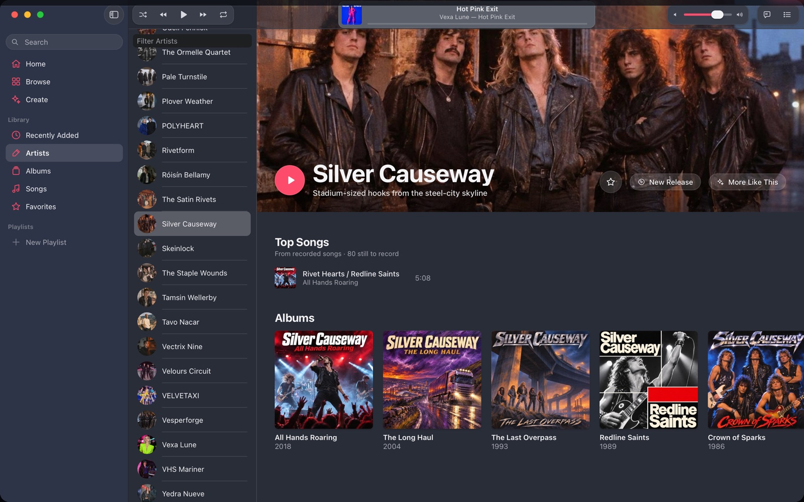
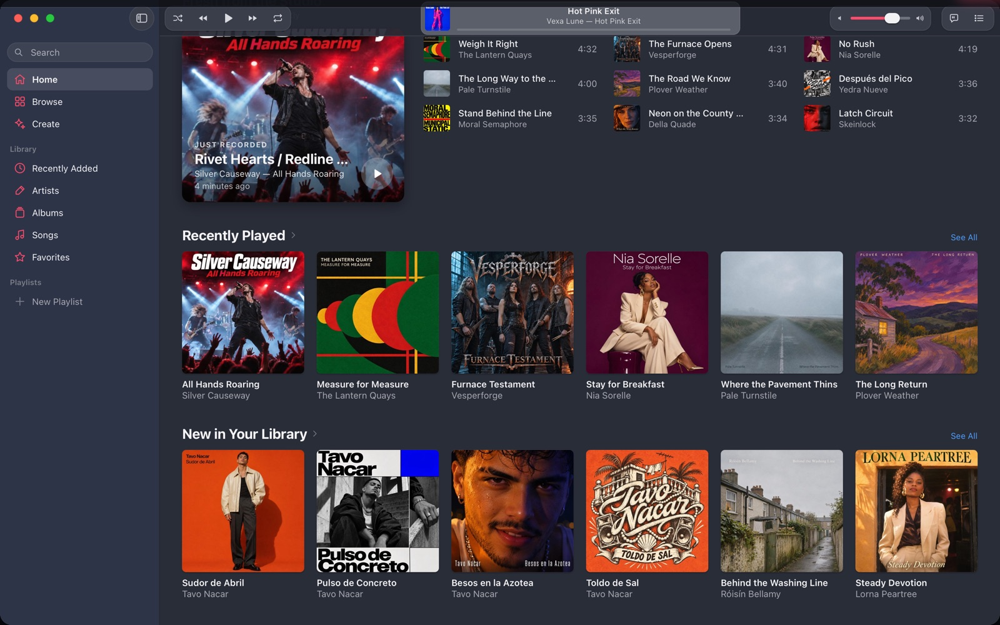
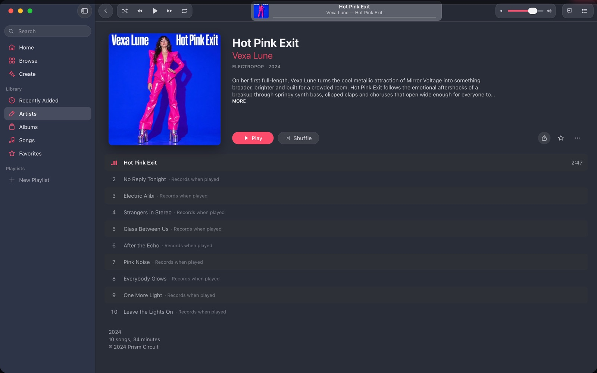
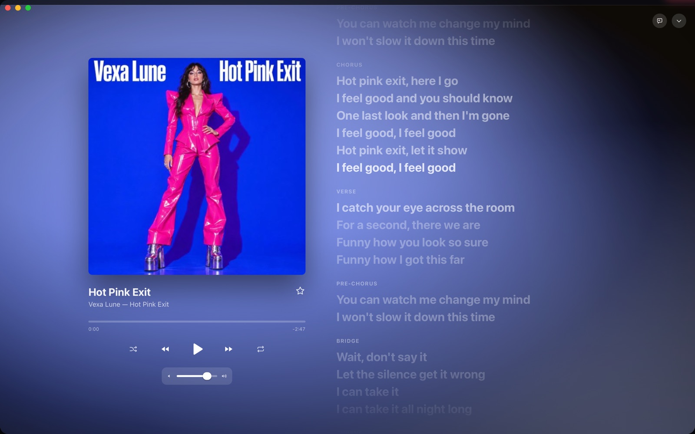
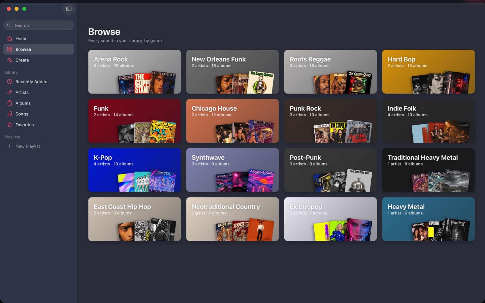

<p align="center">
  
</p>

<h1 align="center">Standard Music</h1>

<p align="center">
  A native macOS music player where every artist, album, cover and song was made for you.<br>
  <a href="https://standard-music.formkit.workers.dev">Website</a> ·
  <a href="https://github.com/justin-schroeder/StandardMusic/releases/latest">Download</a>
</p>

<p align="center">
  
</p>

<table>
  <tr>
    <td></td>
    <td></td>
  </tr>
  <tr>
    <td></td>
    <td></td>
  </tr>
</table>

- **Sign in with ChatGPT.** Your subscription writes the artists, biographies, discographies,
  liner notes and lyrics, and paints the cover art and press photos.
- **Tell it what you like.** Onboarding uses real artists and real album art (a bundled catalog of
  thousands of artists) and a handful of adaptive questions.
- **Get a library.** 100+ fictional artists, leaning toward your taste with neighboring styles
  mixed in, each with a hidden "soul" that defines how they sound and how they changed over time.
- **Press play.** Songs are recorded on your Mac by [YuE2](https://map-yue2.github.io), a 3.6B
  music model, running natively on Apple silicon with MLX. Once recorded, a song stays in your
  library forever. Favorites shape what gets made next.

## Requirements

- Apple silicon Mac (M1 or newer), macOS 26
- ~6 GB free disk for the model, plus ~5 MB per recorded song
- A ChatGPT plan (Plus, Pro, Team, …)

Recording time depends on the chip and the Studio quality setting. On an M1 Pro, a three-minute
song takes about 7 minutes at Balanced quality; newer chips are considerably faster. The studio
records ahead while you listen.

## Building

```sh
brew install xcodegen
tools/build.sh Release        # generates the Xcode project and builds build/dev/…/Standard Music.app
tools/release.sh              # Developer ID signed + notarized build/release/StandardMusic.zip
tools/publish-release.sh 1.1  # bump, build, tag, push, GitHub release with zip + Sparkle appcast.xml
```

Updates use [Sparkle 2](https://sparkle-project.org). The app reads
`releases/latest/download/appcast.xml` (`SUFeedURL` in `StandardMusic/Info.plist`), so the GitHub repo
must be public for update checks to work. Releases are signed with an EdDSA key whose private half lives
only in the release Mac's login keychain (item "Private key for signing Sparkle updates", made by
Sparkle's `generate_keys`); its public half is `SUPublicEDKey`. Back it up with `generate_keys -x <file>`
and import it elsewhere with `generate_keys -f <file>`. If it is lost, installed copies can no longer
verify updates and need a manual download.

Layout:

| Path | What |
|---|---|
| `StandardMusic/` | The SwiftUI app (onboarding, library, player, miniplayer, menu bar, settings) |
| `Engine/` | `StandardMusicEngine`, a helper process that owns the GPU and the model |
| `Packages/YuEKit` | MLX Swift port of YuE2 (tokenizer, AR/NAR transformer, flow matching, VAE) + `yue-cli` |
| `Packages/StandardKit` | Database (GRDB/SQLite), ChatGPT sign-in and client, catalog, taste, library builder |
| `tools/catalog` | Crawler that builds the bundled real-artist catalog |

Development switches: `SM_HOME=<dir>` uses another data directory and `SM_FORCE_PHASE=welcome|onboarding|building|library`
jumps to a phase. `YUE_DTYPE=bf16` forces bfloat16 compute in the engine.

## Data

Everything lives in `~/Library/Application Support/StandardMusic/`: `Library/Library.sqlite`
(WAL, full fsync, verified at launch, rotating backups in `Library/Backups`), `Library/Artwork`,
`Library/Audio`, and `Models/`.

## Licenses

YuE2 weights are CC BY-NC 4.0 (non-commercial); generated audio inherits that restriction.
